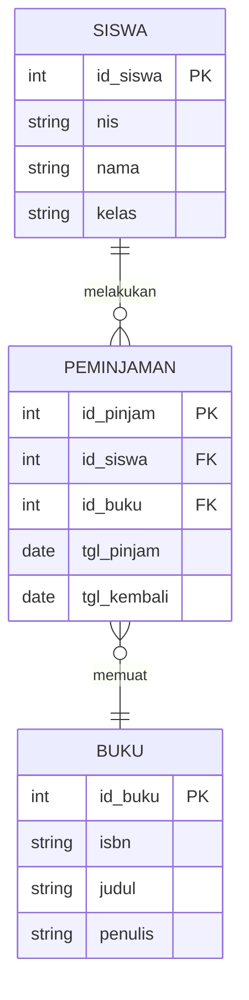

## Apa itu ERD?

**Entity Relationship Diagram (ERD)** adalah diagram visual yang digunakan untuk merancang struktur dan alur logika basis data relasional. ERD memetakan data dalam bentuk objek (entitas), detail data (atribut), serta bagaimana entitas-entitas tersebut saling berhubungan satu sama lain.

<Tip>
  Bayangkan ERD seperti **cetak biru (blueprint)** bangunan sebelum rumah didirikan. Tanpa cetak biru, struktur tabel di database rawan rancu, redudan, atau tidak konsisten.
</Tip>

---

## 3 Komponen Utama ERD

Dalam pemodelan ERD, terdapat tiga elemen dasar yang selalu digunakan:

<CardGroup cols={3}>
  <Card title="Entitas (Entity)" icon="cube">
    Objek konkret atau abstrak di dunia nyata yang datanya ingin disimpan.

    _Contoh: Siswa, Guru, Produk, Transaksi._
  </Card>

  <Card title="Atribut (Attribute)" icon="list-check">
    Karakteristik atau informasi detail yang melekat pada suatu entitas.

    _Contoh pada Siswa: NIS, Nama, Jurusan._
  </Card>

  <Card title="Relasi (Relationship)" icon="diagram-project">
    Hubungan logis yang mengaitkan satu entitas dengan entitas lainnya.

    _Contoh: Siswa **meminjam** Buku._
  </Card>
</CardGroup>

---

## Memahami Kunci (Keys)

Setiap entitas membutuhkan identitas unik agar datanya tidak tertukar:

- **Primary Key (PK):** Atribut penentu identitas unik setiap baris data (tidak boleh kosong/null dan tidak boleh duplikat). _Contoh: `nis` pada entitas Siswa._
- **Foreign Key (FK):** Atribut rujukan di suatu tabel/entitas yang mereferensikan Primary Key dari entitas lain untuk membentuk relasi. _Contoh: `id_kelas` di tabel Siswa._

---

## Derajat Relasi (Kardinalitas)

Kardinalitas mendefinisikan batasan jumlah relasi antar entitas:

| Tipe Relasi | Penjelasan | Contoh Nyata |
| :-- | :-- | :-- |
| **One to One (1:1)** | Satu entitas hanya terhubung dengan satu entitas lain | Siswa memiliki satu akun portal login |
| **One to Many (1:N)** | Satu entitas dapat terhubung dengan banyak data entitas lain | Satu Kelas memiliki banyak Siswa |
| **Many to Many (M:N)** | Banyak entitas di sisi A bisa berelasi ke banyak entitas di sisi B | Siswa memilih banyak Ekstrakurikuler |

<Note>
  Pada implementasi fisik database relasional (seperti MySQL atau PostgreSQL), relasi **Many to Many (M:N)** tidak bisa dihubungkan langsung. Anda harus membuat **tabel perantara (pivot/junction table)**.
</Note>

---

## Studi Kasus Sederhana: Sistem Peminjaman Perpustakaan

Berikut adalah visualisasi ERD relasi antara **Siswa**, **Peminjaman**, dan **Buku** menggunakan diagram Mermaid yang didukung penuh oleh Mintlify:

