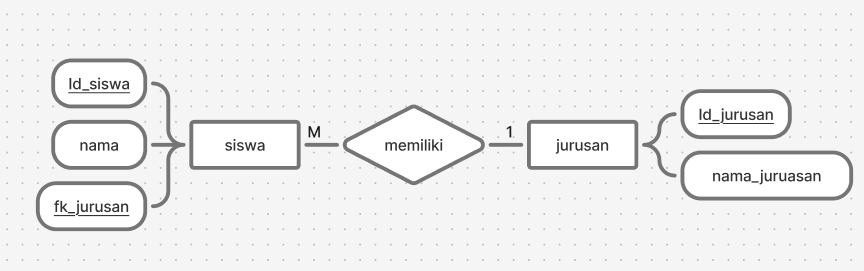

<Tip>
  **Indikator**

  1.2.3.   Menyusun Dokumen Perancangan Database Menerapkan perintah SQL untuk membuat, mengubah, dan menghapus struktur tabel (DDL).

  1.2.4.   Menerapkan perintah SQL untuk mengelola data (menambah, mengubah, menghapus, dan menampilkan data) menggunakan DML dan DCL untuk mengelola data serta hak akses pengguna.
</Tip>

Bayangkan database itu seperti **Lemari Arsip Sekolah** yang berisi banyak folder (Tabel).

Jika DDL (_Data Definition Language_) adalah tukang kayu yang _membuat_ lemari dan map tersebut, maka **DML (_Data Manipulation Language_)** adalah staf tata usaha yang _mengisi, membaca, mengubah, dan membuang_ kertas dokumen di dalam folder tersebut.

DML adalah cara interaksi aplikasi dengan database. DML terdiri dari 4 perintah utama yang sering disebut dengan istilah **CRUD** (_Create, Read, Update, Delete_).

---

## 1. INSERT (Memasukkan Data Baru)

<Note>
  **Analogi:** Ada siswa baru yang mendaftar. Anda mengambil selembar kertas kosong, menuliskan biodata siswa tersebut, lalu memasukannya ke dalam folder `siswa`.
</Note>

Perintah `INSERT` digunakan untuk menambahkan baris data (rekaman) baru ke dalam tabel.

```sql
-- Memasukkan satu data siswa baru
INSERT INTO siswa (nama, kelas) 
VALUES ('Budi Santoso', 'XI TJKT 2');
```

**Penjelasan:**

- `INSERT INTO siswa`: Kita beri tahu sistem, "Tolong buka folder bernama `siswa`".
- `(nama, kelas)`: Kita tentukan kolom apa saja yang mau diisi.
- `VALUES (...)`: Ini adalah isi tulisan di kertasnya (datanya).

## 2. SELECT (Mencari dan Membaca Data)

<Note>
  **Analogi:** Guru meminta Anda mencari siapa saja siswa yang duduk di kelas 'XI TJKT 1'. Anda membuka folder `siswa`, menelusuri kertas satu per satu, dan membacakan nama-nama yang sesuai.
</Note>

Perintah `SELECT` digunakan untuk menampilkan atau mengambil data dari tabel. Ini adalah perintah SQL yang paling sering digunakan!

```sql
-- Mengambil semua kolom (*) dari tabel siswa
SELECT * FROM siswa;

-- Mengambil nama saja, khusus untuk anak kelas XI TJKT 1
SELECT nama FROM siswa 
WHERE kelas = 'XI TJKT 2';
```

**Penjelasan:**

- `SELECT *`: Tanda bintang `*` artinya "Ambil semua data yang ada".
- `WHERE`: Ini adalah _filter_ atau penyaring. Seperti berkata, "Jangan ambil semua, ambil yang kelasnya XI TJKT 1 saja."

## 3. UPDATE (Mengubah Data)

<Note>
  **Analogi:** Budi Santoso pindah rumah. Anda tidak perlu membuang kertas biodata Budi dan membuat yang baru. Anda cukup mengambil kertas Budi, mencoret alamat yang lama, dan menimpa dengan tulisan alamat yang baru.
</Note>

Perintah `UPDATE` digunakan untuk memodifikasi data yang _sudah ada_ di dalam tabel.

```sql
-- Mengubah kelas Budi yang naik kelas
UPDATE siswa 
SET kelas = 'XII TJKT 2' 
WHERE id_siswa = '1';
```

<Warning>
  **Awas Lupa WHERE!** Jika Anda menjalankan `UPDATE siswa SET kelas = 'XII TJKT 2';` TANPA menggunakan `WHERE`, maka **SEMUA** siswa di sekolah tersebut akan berubah menjadi kelas XII TJKT 1. Ini seperti Anda mencoret seluruh kertas di dalam folder tanpa melihat nama!
</Warning>

## 4. DELETE (Menghapus Data)

<Note>
  **Analogi:** Budi sudah lulus dari sekolah. Kertas biodatanya dikeluarkan dari folder `siswa` dan dimasukkan ke mesin penghancur kertas agar lemari arsip tidak penuh.
</Note>

Perintah `DELETE` digunakan untuk menghapus baris data dari tabel.

```sql
-- Menghapus data siswa bernama Budi
DELETE FROM siswa 
WHERE id_siswa = '1';
```

<Warning>
  **Sama berbahayanya dengan UPDATE!** Jika Anda menjalankan `DELETE FROM siswa;` tanpa `WHERE`, bersiaplah dipanggil Kepala Sekolah karena Anda baru saja menghapus data **seluruh** siswa di folder tersebut!
</Warning>

---

## Contoh

kita akan isi tabel berikut :


